# Project_Zuikoh 実験ノート

合成開口レーダ（SAR）・衛星写真・公開の運行データから、世界の変化と動きを時系列で見えるようにする。学習した Sin の板（Sin レイヤフィルム）で反応を調べ、知らない成分を連番で登録・単離していく。数字の正本。

> ファイル配置: 実験のプログラムは `experiments/expNN_名前.py`、条件は `experiments/sweeps/sweepNN.sh`、結果は `results/expNN.txt`（1 回の実行 = 1 行の JSON）、図は `tools/fig_*.py` から `docs/images/` に。リポジトリ直下で実行する。データは F: の置き場（設定 `ZUIKOH_DATA` か `config.local.toml`）、扱いに気をつけるものは D:\AI_git\Project_Zuikoh_private。決まりは [CLAUDE.md](CLAUDE.md)。

## 現時点のまとめ（2026-10-31 更新）

**いまの最良の構成**: まだない（M0 の途中。クッシングの見本を地図に重ねたところ）。

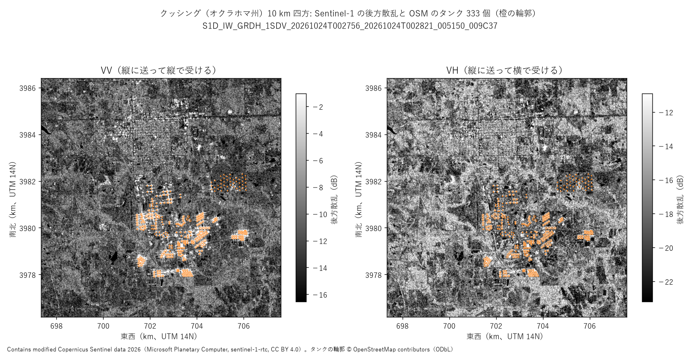

| 目標 | 状況 |
|---|---|
| M0: 道具とデータの確認 | データの出どころの下書き（[docs/data_sources.md](docs/data_sources.md)）、先行研究の下書き（[docs/prior_art.md](docs/prior_art.md)）。ライブラリを .venv に入れて確認表（[docs/library_check.md](docs/library_check.md)）。クッシングの見本（Sentinel-1 RTC 2026-10-24、10 km 四方）と OSM のタンク 333 個を取り、図と地図（Leaflet）に重ねた。取り込みの重さは 50 km 四方でも 20 秒・93 MB（実験00）。残り: COG の部分読みと全体読みの一致 |
| M1: 持ち主の案 1（同じ形の物、Sin レイヤフィルムの反応） | 浮き屋根の石油タンク・オクラホマ州クッシング（2026-10-31 持ち主）。比較相手の最初の値: テンプレートの照合 F1 0.48、CFAR 0.37、偶然 0.01〜0.03（実験01、1 日付）。Sin レイヤフィルムはまだ |
| M2: 持ち主の案 2（衛星写真と SAR を一緒に、トウモロコシ畑） | 未着手 |
| M3: 持ち主の案 3・4（撮影時刻の写真、知らない成分の登録） | 未着手 |
| M4: 持ち主の案 5・6（登録と単離の繰り返し、船・電車） | 未着手 |
| M5: 持ち主の案 7（地図の表示と受け渡しの形） | 未着手 |

**効いた工夫**: （まだない）
**効かなかった工夫**: （まだない）

**追記 (10/31)**: 調べた範囲では、Sentinel-1（10 m）で浮き屋根の高さや 1 台ずつの車を測った研究は見つからなかった。Sentinel-1 では「物があるか・数・場所全体の明るさの時系列」までが現実的で、細かいものは高分解能のオープンデータ（Umbra・Capella、場所は選べない）で確かめる見込み（docs/prior_art.md）。

**追記 (10/31 午前)**: 10 km 四方の VV の画像で、タンクの多くは明るい点として見え、強い点のまわりに十字の尾（装置のぼけ = sinc のサイドローブ）が出ている。持ち主の「反射の特徴が畳み込まれている」の具体例（docs/design_subpixel.md 1 節）。

**追記 (10/31 昼)**: 浮き屋根の高さは、SLC（複素数の画像）なら測れる見込み。屋根 10 m の上下は SLC の距離の画素で 3.3 個分のずれになり、角の点が背景より 15 dB 明るければ高さを約 0.25 m で測れる（est_01、作り物、3 seed）。手元の 10 m の画像では、タンクの強い点は背景より中央値 28 dB 明るい（est_01b）。ただし強い点が屋根と壁の角かは未確認。

**追記 (10/31 昼)**: クッシングの 1 年分（29 日付）を取った。タンク全体の強い点の明るさは 1 年を通じて ±1 dB 以内で安定し、衛星が 1A から 1D に替わっても物差しはずれていない（VV で差 0.03 dB）。畑の VH には作物の季節の波が出ている（M2 の手がかり）。

**追記 (10/31 夕)**: 定番の検出の最初の値（クッシング、1 日付、正解 = OSM 333 基）: テンプレートの照合が F1 0.48（再現率 0.42・適合率 0.57）、CFAR が F1 0.37、偶然 0.01〜0.03（実験01）。密集したタンクが 1 つの山にまとまるので、再現率は 0.58 で頭打ち。

**追記 (10/31 夕)**: SLC の実物（クッシング、2026-10-24）でも、タンクの強い点は背景より中央値 33.9 dB 明るく、80% が 15 dB 以上（est_01c）。ただし 1 基の中に強い点がいくつもあり（距離の向きに中央値 10 個の山）、est_01 の「点 1 つ」の仮定は楽観的。どの点が屋根と一緒に動くかは、日付を重ねて見分ける必要がある。GCP だけの位置づけは 76 行（約 1 km）ずれていて、タンクの並びとの相関で直した。

**追記 (10/31 夜)**: 2 日付（12 日おき）の SLC で、タンクの強い点の 36% が距離の向きに 1 m 以上動いた。動かないはずの対照の点（町の建物など）では 11%、ばらつき ±0.26 m（est_01d）。浮き屋根の動きの候補だが、正解（在庫の記録）と突き合わせるまでは「タンクの点は動いて見える」まで。

**追記 (10/31 夜)**: 6 日付（12 日おき）に増やすと、タンクの点の 5〜7 割が「動く」が、見立て「手前の点は動かず、奥だけ動く」は確かめられなかった（探す幅をタンクの半径に絞ると、逆に手前のほうが動く: 70% 対 47%）。主な原因の見立ては、タンクの中心の位置が明るい点に引っぱられていること（位置合わせの方法の偏り）。動かない対照の点でも 18% が「動く」と出るので、測り方そのものの取り違えも大きい（est_01e）。

**追記 (10/31 夜)**: タンクはいったん中止（持ち主）。ベンチマークのオクラホマの NISAR の反射板（2.8 m、公開の座標）4 基が、すでに取った SLC に写っていた。反射板の距離の向きの位置は 6 日付で ±0.09〜0.17 m しかぶれない（est_02）。同じ測り方で、タンクの点は ±0.6〜1.6 m ぶれていたので、タンクのぶれは測り方の雑音ではなく、タンクの側（点が弧・点がいくつも・屋根の動き・位置合わせ）にある。進行方向の測り方には TOPS の位相の傾きを直す処理が要る（未対応）。

**追記 (10/31 夜)**: 持ち主の問い「点どうしの関係を周波数成分に」: クッシングの町の動かない点 69 個の位相の差は、日付の組ごとに 1 本の縞（−1.3〜+5.1 本/km）でよく説明でき（点のそろい具合 0.86〜0.92、偶然なら 0.39 まで）、縞は日付どうしで矛盾なく足し引きできた（閉じ具合の差 0）。縞を引いた残りは約 2 mm。畑の中の反射板 N08K の周り（弱い点 29 個）では偶然と区別できなかった（est_03）。

**追記 (10/31 深夜)**: 反射板を見分ける学習（実験02、反射板ごとに訓練とテストを分ける）: 明るさをそろえた形だけでも、小さな CNN（振幅）は正解率 93.7%・反射板の見落としなし。Sin の板は振幅を入れると 81.7%、複素数のまま入れると 50.8% と大きく崩れた（考察: SLC の位相の傾き = 斜めの照明でレンズの後の像がずれる。確かめを回している）。真ん中を隠して周りだけ（残りが元の山の −20 dB 以下）でも、CNN は反射板の 4 割を当てた（偶然 4.7%）。

**追記 (11/01)**: 持ち主の方針（軌道の補正はせず、データの相関だけ）で、2 日付の干渉データ（A·conj(B)）を Sin の板に入れると、複素数の正解率は 50.8 → 64.8% に上がった（斑点の位相の打ち消し）。ただし振幅（86.0%）・CNN（88.9%）にはまだ届かない（実験04）。

**追記 (11/01 夕)**: 2 本の光路の融合（振幅の光路 + 干渉の位相の光路、明るさを足す）は 83.7%。学習する数をそろえた振幅だけの 1 本（板 16 枚、82.7%）とほぼ同じで、位相の光路の上乗せは見えなかった（実験05）。CNN（89.3%）にはまだ届かない。

**追記 (11/01 夕)**: 飛行場（バンコク、Umbra の GEC 24 日付）の駐機位置 190 か所の明るさは、一見「強い日・弱い日」に分かれた（82%）が、**見かけだけだった（悪い結果）**。2024 年以降の画像（作り方の違う版）がまとめて明るかったことと、日付ごとに画像の位置が数十 m ずれていること（同じ駐機位置の切り出しに別の物が写る）が原因。次はデータどうしの相関で位置を合わせ直す（est_04）。

**未解決**: restricted/ を止める仕組みの確かめ。高分解能のデータで場所を選べないこと。
**一貫した教訓**: （まだない）

## 目標
- （2026-10-31 持ち主の依頼）世界の変化と動きを調べるシステムを作る。SAR・衛星写真・公開の運行データから、建物の変化・遺跡の捜索・船や電車の運行を時系列で見えるようにし、人の判断や AI の研究に使える形（地図の上の表示と、機械が読めるデータの形）にする。最初はガスタンク・石油タンク・トウモロコシ畑から、その後に船・電車・車へ
- （2026-10-31 持ち主の案）進め方の骨格: (1) SAR を学習した Sin レイヤフィルムに場面を通し、スクリーンのどこが光るかで物を調べる (2) 衛星写真と SAR を一緒に学ぶ (3) SAR の撮影中に駐車場などの写真を撮り、鶴亀算で車種ごとの反応を確かめる (4) 差から動く物の周波数成分を取り出し、説明できない成分を「知らない成分」として連番で登録 (5) 確信度が上がったら「学習済み」に登録、名前を調べる (6) 1〜5 の繰り返し (7) 世界地図にピン・航跡・建物の変化の色、地図に載っていない地形の拾い出し
- （2026-10-31 持ち主の答え）最初の地域はアメリカ。日本で写真を撮れるのは宮崎県内に限られる
- （2026-10-31 持ち主の答え）M1 はクッシングの石油タンク。タンクの地帯は攻撃に直結する資料ではないので公開してよい。ライブラリは .venv に
- （2026-10-31 持ち主の案）10 m の格子より細かい情報を、レーダの位相差・2 種類の周波数から取り出せないか。反射波の特徴が拡散して畳み込まれている（ぼけて混ざっている）可能性も調べる
- （2026-10-31 持ち主の案）SAR の確かめ用に、動きが少なく寸法が正確に分かり、昼夜で伸び縮みが見込める材質のランドマーク（ギザのピラミッドなど）を使う → 候補は docs/landmarks.md
- （2026-10-31 夜 持ち主）タンクの案はいったん中止。ベンチマークとして、角の反射板の試験場と、電波の乱反射の少ない建物・地形を選ぶ → docs/landmarks.md の後半
- （2026-10-31 夜 持ち主の案）データ不足には、干渉 SAR のように差分を使い、衛星の移動に伴うフレーム（帯域を分けた像 = サブバンド・サブルック）で水増しする。民間の飛行場・保管場の同型機を同じ形の物として使う（軍の保管場は避ける）
- （2026-11-01 持ち主）軌道の情報による補正はしない（相対性理論などまで考える必要が出てくるため）。同じ撮影の中のデータ、または干渉データの相関だけで進める

## 環境とコードの出どころ
- PC: Windows 11、GPU は RTX 3060 12GB × 2（共通の待ち行列で使う）
- Python 3.14.7、PyTorch 2.14.1+cu126、numpy 2.5.2、matplotlib 3.11.2、pytest 9.1.1、pyarrow 26.0.0（2026-10-31）。地図・衛星のライブラリはリポジトリの .venv/（--system-site-packages）に入れた: rasterio 1.5.2（GDAL 3.12.2）、pyproj 3.8.0、shapely 2.2.0、pystac-client 0.9.1、planetary-computer 1.0.0、scipy 1.18.1、scikit-learn 1.9.1、requests 2.34.2、psutil 7.2.2（docs/library_check.md）
- 公開リポジトリ: https://github.com/devaf09/Project_Zuikoh （2026-10-31 作成、持ち主の確認の後）
- vendor: SinWave2D 0.3.0（Project_Metasequoia 811494d）、SN2-Parts-2D 0.11.0（5238c39）。バイト単位で同じ（vendor/README.md）
- 読んだだけで書き換えていないプロジェクト: Sin-CNN2、Project_Metasequoia、SN2-Parts-2D、Sin-CNN3、SinCrest
- **restricted/ を止める仕組み**: .claude/settings.json の permissions.deny に、restricted/ を読む Read・Edit と、"restricted" を含む Bash・PowerShell のコマンドを入れた。効くかの確かめ:
  - 2026-10-31（立ち上げのセッション）: **まだ確かめられていない**。立ち上げのセッションは作業フォルダが D:\AI_git\TmpFiles のままで、この settings.json が読み込まれない。試しのファイル（中身はただの合言葉）を Read・PowerShell で開けてしまい、Bash は場所が違って開けなかった。つまり「このフォルダ以外で始めたセッションには、この仕組みは効かない」。
    途中で作業フォルダを D:\AI_git\Project_Zuikoh に移してから試し直しても、Read・Bash の cat・PowerShell の Get-Content の 4 通りすべてで開けた（対照のファイルも読めた）。設定がセッションの開始時にしか読まれないためか、書き方の誤りかは、まだ分けられていない
  - 確かめ方（D:\AI_git\Project_Zuikoh で始めたセッションで最初にする）: `restricted/deny_test.txt`・`F:/AI_git/Project_Zuikoh_Data_Files/restricted/deny_test.txt` を Read・Bash の cat・PowerShell の Get-Content で開こうとし、すべて断られること。対照として `F:/AI_git/Project_Zuikoh_Data_Files/cache/open_test.txt` は読めること。結果をここに書く
  - 注意: 本物の「送らないもの」は、この確かめが済むまで restricted/ に置かないでほしい（持ち主へ）

## データの出どころ
- 一覧は [docs/data_sources.md](docs/data_sources.md)。取得したものは F: の MANIFEST.md に書く。2026-10-31: Sentinel-1 SLC（ASF、Earthdata のトークン）の S1D_IW_SLC__1SDV_20261024T002754_…_7A08 と S1D_IW_SLC__1SDV_20261012T002754_…_9921 ほか 2026-08-25・09-06・09-18・09-30（計 6 場面、各 4.6 GB、合計約 28 GB。すべて上昇軌道 34）。Sentinel-1 RTC（Planetary Computer、CC BY 4.0）の、クッシングの 10 km 四方の VV・VH を 29 日付（2025-11-03〜2026-10-24、上昇軌道 34、Sentinel-1A 19 回・1D 10 回、計 208 MB）。OSM（Overpass、ODbL）のタンクの輪郭 333 個（同じ範囲）

## 実験00: 取り込みの重さ (exp00_fetch_cost.py、sweep00.sh)
着想: 開始プロンプト 9 章「大きさごとの時間・メモリ・ディスクを最初に測る」。M1 の見積もり（docs/design_m0_m1.md）の裏づけ。
条件: Sentinel-1 RTC の VV、同じ 1 場面（2026-10-24、クッシング中心）。COG から範囲だけ読んで保存 → 経度・緯度の格子に置き直す。CPU（4 スレッド、優先度を下げて）、2 回ずつ（乱数なし、seed 0）。

| 一辺 | 画素 | 目録の検索 | 読む + 保存 | 置き直し | 保存の大きさ | メモリの最大 |
|---|---|---|---|---|---|---|
| 1 km | 102 × 103 | 2.3 秒 | 3.0 秒 | 0.01 秒 | 0.04 MB | 592 MB |
| 10 km | 1021 × 1025 | 2.3 秒 | 7.0 / 5.8 秒 | 0.1 秒 | 3.7 MB | 628 MB |
| 50 km | 5104 × 5125 | 3.1 / 2.4 秒 | 19.9 / 18.4 秒 | 1.9 秒 | 93 MB | 1,046 MB |

- **結論: 取り込みは軽い。50 km 四方 1 偏波 1 日付でも約 20 秒・93 MB。** M1 の見積もり（3 地域 × 20 km 四方 × 60 日付 × 2 偏波）は約 15 MB × 360 = 約 5 GB、読む時間は約 1 時間（ネット次第）と考えられる
- メモリの約 590 MB は PyTorch などを読み込んだ分の土台で、50 km で +450 MB。画像の大きさ（26 M 画素 × 4 バイト = 105 MB）の約 4 倍で、読む・保存・置き直しの写しがいくつか重なっていると考えられる
- 時間の多くはネットから読む時間（1 km でも 3 秒）。同じ場所の日付を並べて取るときは、まとめて読む工夫の余地がある
- 次の一手: COG の部分読みと全体読みの一致を確かめる（docs/library_check.md の −）。M1 の時系列の取得（tools/fetch_s1_rtc.py の --max-items を増やす）

## est_01: 浮き屋根のずれの見積もり (est_01_tank_roof_shift.py)
着想: 持ち主の案（2026-10-31）「位相差・畳み込みから 10 m より細かく」。docs/design_subpixel.md 2 節の概算を数で確かめる。
条件: 作り物の 1 次元（距離の向き）。Sentinel-1 IW の SLC を仮定（距離の画素 2.33 m、分解能 2.7 m、点の写り方 sinc）。周りの斑点も同じ帯域で畳み込む。山を 8 倍の補間 + 放物線で探す。入射角 39 度。点の位置は試行ごとに画素の中ででたらめ。2,000 回 × 3 seed。

| 点と斑点の比（SCR） | 位置の誤差 | 屋根の高さの誤差 | 大外れ（別の山を拾う） |
|---|---|---|---|
| 0 dB | 4.3〜4.5 m | 5.5〜5.7 m | 52〜54% |
| 5 dB | 3.0〜3.1 m | 3.9〜4.0 m | 26〜27% |
| 10 dB | 0.74〜0.87 m | 0.95〜1.12 m | 1.6〜1.7% |
| 15 dB | 0.19 m | **0.24〜0.25 m** | 0% |
| 20 dB | 0.10〜0.11 m | 0.14 m | 0% |
| 30 dB | 0.03 m | 0.04 m | 0% |

- **結論: 屋根 10 m の上下は SLC の距離の画素で 3.3 個分のずれ。角の点が背景より 15 dB 以上明るければ、屋根の高さを約 0.25 m（タンクの高さ約 15 m の 2% ほど）で測れる見込み。** 10 dB を下回ると別の山を拾い始め、急に崩れる
- 見立て（「10 m では満ち具合は見えない」、docs/prior_art.md）は、加工済みの画像についてはそのまま、SLC については外れる見込み（ここは作り物の結論）
- 入れていないこと: 進行方向（14 m）のぼけ、同じ画素にある別の強い点（壁の上端・屋根の縁は高さが変わらない）、タンクの丸い形、軌道の誤差、大気の遅れ。とくに「動かない点が近くにある」と山が混ざるので、実物では est_01 より悪くなると考えられる
- 次の一手: est_01b で実物の明るさの比の目安を測る。Earthdata のアカウントができたら、クッシングの SLC で角の点の位置の時系列を追い、EIA の在庫の週の数字と比べる（docs/design_subpixel.md 提案 C）

## est_01b: タンクの強い点の明るさの比 (est_01b_tank_peak_ratio.py)
着想: est_01 の結論は SCR しだい。手元の RTC（10 m）で実物の目安を測る。
条件: クッシング 10 km 四方、2026-10-24 の VV。OSM のタンク 333 基ごとに、中心の周りで最も明るい画素 / 範囲全体の中央値（ほとんど畑、−10.8 dB）。

| タンクの直径 | 数 | 明るさの比（中央値） |
|---|---|---|
| 30 m 未満 | 2 | 13.9 dB |
| 30〜60 m | 146 | 20.5 dB |
| 60 m 以上 | 185 | 31.4 dB |
| 全体 | 333 | **28.1 dB**（25〜75%: 20.2〜33.0、15 dB 以上は 86%） |

- **結論: タンクの強い点は背景よりずっと明るく、est_01 の「15 dB 以上」はほとんどのタンクで満たす見込み。** 大きいタンクほど明るい
- 注意: RTC は平均して斑点を減らした画像なので、SLC の 1 回分の比とは違う。最も明るい点が屋根と壁の角かどうかは分からない（壁の上端などかもしれない）
- 次の一手: SLC で確かめる（アカウント待ち）。それまでは、Umbra・Capella の高分解能のデータにタンクの地帯があるか探す

## M1 の下ごしらえ: クッシングの 1 年の時系列 (tools/fig_m1_timeseries.py)
条件: クッシング 10 km 四方、Sentinel-1 RTC の 29 日付（2025-11-03〜2026-10-24、12 日ごと。2026-06〜07 は 1C の軌道の調整と 1A の運用終了で間があく）。タンク 333 基ごとの最も明るい画素の中央値と、範囲全体の中央値。数値は results/m1_timeseries.txt。

| 偏波 | 衛星 | 日付の数 | タンク（dB、平均 ± ばらつき） | 範囲全体（dB） |
|---|---|---|---|---|
| VV | Sentinel-1A | 19 | 17.39 ± 0.96 | −10.78 ± 0.56 |
| VV | Sentinel-1D | 10 | 17.36 ± 0.84 | −10.90 ± 0.55 |
| VH | Sentinel-1A | 19 | −3.14 ± 0.27 | −17.23 ± 0.71 |
| VH | Sentinel-1D | 10 | −3.34 ± 0.40 | −16.84 ± 0.51 |

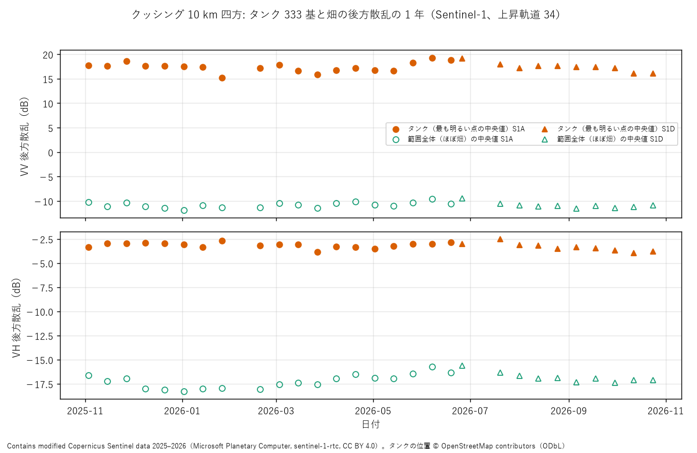

- **結論: タンクの地帯の明るさは 1 年を通じて安定していて、衛星が替わっても物差しはほぼ同じ（VV で 0.03 dB、VH で 0.2 dB の差）。** M1 の学習で 1A と 1D の日付を混ぜてよいと考えられる
- タンク全体の中央値では、満ち具合の変化（あるとしても）は見えない。1 基ごとの時系列で見る必要がある（10 m では見えない見込み、est_01 のとおり SLC が要る）
- 畑の VH は、冬に低く（−18 dB）、春〜夏に上がる（−15.7 dB）。作物の育ちと考えられる（M2 の手がかり）
- 次の一手: M1 の正解作り（OSM のタンクを NAIP で数枚確かめる）、学習しない地域（ミッドランド）の取得、CFAR とテンプレートの照合で最初の比較

## 実験01: 定番の検出でタンクを見つける (exp01_baseline_detect.py)
着想: M1 の設計（docs/design_m0_m1.md）。Sin レイヤフィルムと比べる前に、学習しない定番の手法の値を出す。
条件: クッシング 10 km 四方、Sentinel-1 RTC の VV、2026-10-24 の 1 日付。正解は OSM のタンク 333 基（輪郭を円で近似、+10 m の余裕の中に山があれば当たり）。近い山は 4 画素（40 m）でまとめる。学習する数は 0。CFAR・テンプレートは乱数なし、偶然の水準は seed 0〜2。

| 方法 | 条件 | 山の数 | 再現率 | 適合率 | F1 | 誤報 / km² |
|---|---|---|---|---|---|---|
| 偶然（同じ数の山をでたらめに） | 247 個 | 247 | 0.006〜0.012 | 0.008〜0.016 | 0.007〜0.014 | 2.3 |
| CFAR（セル平均） | pfa 1e-6 | 347 | 0.381 | 0.366 | 0.373 | 2.10 |
| CFAR | pfa 1e-2 | 1107 | 0.580 | 0.181 | 0.276 | 8.67 |
| テンプレートの照合（直径 60 m の円） | 上位 0.5% | 492 | 0.553 | 0.382 | 0.452 | 2.90 |
| **テンプレートの照合** | **上位 0.2%** | 247 | 0.417 | **0.567** | **0.481** | **1.02** |

- **結論: 学習しない定番の手法は、偶然よりずっと良いが F1 0.48 止まり。テンプレートの照合が CFAR を上回った（0.48 対 0.37）。** M1 の Sin レイヤフィルムが越えるべき最初の線
- 再現率はしきい値を下げても 0.58 で頭打ち。密集したタンク（直径 60 m 前後が数十 m おき）が 1 つの山にまとまるためと考えられる（山をまとめる距離 40 m と、10 m の画像のぼけ）
- 誤報には、町の建物など「タンクではない強い反射」と、OSM に載っていないタンクの両方が混ざっていると考えられる。正解の確かめ（航空写真）をしないと、適合率は低めに出ている可能性がある
- 1 日付・1 地域・seed なしの値。学習しない地域・ほかの日付での確かめはまだ
- 次の一手: 正解の確かめ（NAIP で 1 km 四方を数枚）、学習しない地域、1 基ごとの数え方（密集の中の個数を数える指標）、Sin レイヤフィルム 0.1.0

## est_01c: SLC の実物でタンクの強い点を見る (est_01c_slc_tank_points.py、tools/fig_est01c.py)
着想: est_01（作り物）と est_01b（加工済みの 10 m の画像）の確かめ。1 回分の複素数の画像（SLC）で、強い点の明るさの比（SCR）と、1 基の中の点の数を見る。
条件: クッシング、Sentinel-1D の SLC（2026-10-24、上昇軌道 34、IW3、VV）。ZIP を展開せずに読む。OSM のタンク 333 基。背景 = 切り出し全体の中央値。

- **位置合わせ**: 付属の目印の点（GCP）だけでは、タンクの並びと画像の明るい点の並びが **進行方向に 76 行（約 1 km）・距離の向きに 16 画素**ずれていた。GCP がバーストの重なりを考えていないためと考えられる。2 つの並びの相関で直した（相関の山の強さ 13.2、はっきりした山）。直す前は SCR の中央値が 13.1 dB と出ていて、**直さないと結論を誤る**
- 結果（位置合わせ後）:

| 指標 | 値 | 比べるもの |
|---|---|---|
| 強い点の比 SCR（中央値） | **33.9 dB**（25〜75%: 19.1〜41.4） | est_01b（10 m の画像）28.1 dB |
| 15 dB 以上の割合 | **80%** | est_01b 86% |
| 1 基の中の、距離の向きの山（背景より 10 dB 以上）の数 | 中央値 10 | est_01 の仮定は 1 個 |

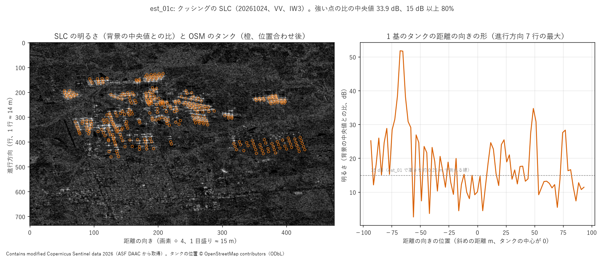

- **結論: 明るさは十分（est_01 の 15 dB の線を 8 割のタンクが越える）。ただし 1 基の中に強い点がいくつもあり、「点 1 つ」の仮定は楽観的。** 図の例では、手前（−70 m）にとても強い点（52 dB）、奥（+50 m）に次の強い点（35 dB）があり、その間に装置のぼけの尾（サイドローブ）とほかの点が並ぶ
- 手前の強い点は、壁と地面の角（2 回はね返り、高さが変わらない）、奥の点は屋根と壁の角（屋根と一緒に動くはず）と考えられる（見立て、1 基の例だけ）。どの点が動くかは、**日付を重ねて、位置が変わる点を探す**ことで見分けられるはず
- 山の数の 10 は、サイドローブ（装置のぼけ）と、となりのタンクの点を数えているぶん多めに出ている
- 次の一手: 同じ軌道の別の日付（2026-10-12）の SLC を取り、点ごとの距離の位置の変化を比べる（屋根の動きの候補）。あわせて 2 日付の位相のそろい具合（コヒーレンス）

## est_01d: 2 日付の SLC で、タンクの強い点の動きを見る (est_01d_slc_two_dates.py、tools/fig_est01d.py)
着想: est_01c で 1 基に強い点がいくつもあった。屋根と一緒に動く点は、日付を重ねると距離の向きに動くはず（est_01）。
条件: クッシング、Sentinel-1D の SLC 2 日付（2026-10-12 → 10-24、同じ軌道 34・IW3・VV）。2 日付の全体のずれ（行 −0.88・列 +22.82 画素）を明るさの相関で測って引く。タンクの中の強い点（背景より 20 dB 以上）ごとに、距離の向きの山の位置を 8 倍の補間 + 放物線で決め、動き = B − A。**対照**: タンクから離れた強い点（町の建物など、動かないはず）を同じ測り方で。

| 点 | 数 | 動きのばらつき（外れに強い標準偏差） | \|動き\| > 1 m の割合 | 2 日付の位相のそろい具合（中央値） |
|---|---|---|---|---|
| 対照（タンクから離れた強い点） | 199 | **0.26 m**（高さに直すと 0.33 m） | 11% | 0.24（タンク以外の全体） |
| タンクの強い点 | 1,026（234 基） | 0.71 m | **36%**（131 基で大きく動いた点あり） | 0.42 |

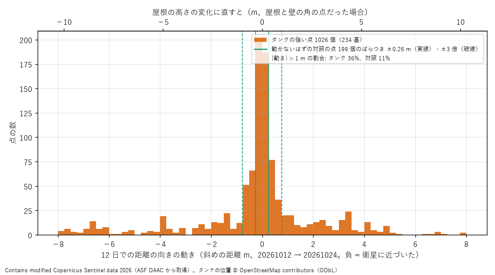

- **結論: タンクの強い点は、動かないはずの点より明らかによく動いて見える（1 m 以上動いた割合 36% 対 11%）。** 12 日で屋根が動いたタンクがある、という見立てと合う。ただし正解（タンクごとの在庫）がないので、**動きが屋根の動きかどうかはまだ言えない**
- 動かない点のばらつき 0.26 m は、est_01 の作り物（SCR 20〜30 dB で 0.03〜0.1 m）より 3〜8 倍大きい。軌道のわずかな違い（位置で変わるずれ）や、近くの点どうしの重なりが入っていると考えられる。それでも高さに直して約 0.3 m で、タンクの高さ（約 15 m）に比べて十分小さい
- タンクの場所は位相が比較的そろう（0.42 対 0.24）。金属の大きな構造は 12 日たっても反射の仕方が保たれると考えられる
- 動きは ±8 m まで広がっている。屋根の 1 日あたりの上下としては大きすぎるものも混ざるので、別の山を拾った取り違えも含まれていると考えられる（±4 画素までに制限している）
- 次の一手: (1) 日付を増やし（同じ軌道の SLC を数回分）、1 基ごとに「手前の点は動かず、奥の点だけ動く」形になっているかを見る (2) 正解として、EIA のクッシングの週の在庫の変化と、動いたタンクの数・量の合計を比べる (3) 位置が変わる点の見分けを Sin レイヤフィルムの課題にする（持ち主の案 4「動く物の成分」）

## est_01e: 6 日付の SLC で、タンクの点の動きの形を見る (est_01e_slc_time_series.py、tools/fig_est01e.py)
着想: est_01d で、12 日でタンクの点の 36% が 1 m 以上動いた。見立て: 手前（衛星に近い側）の強い点 = 壁と地面の角（動かない）、奥の点 = 屋根と壁の角（屋根と一緒に動く）。正解がなくても、この「手前と奥の違い」は確かめられるはず。
条件: クッシング、Sentinel-1D の SLC 6 日付（2026-08-25〜10-24、12 日おき、軌道 34・IW3・VV）。基準 = 10-24。日付ごとに全体のずれ（列で −23〜+12 画素）を引く。点ごとに 6 日付の位置のばらつき（標準偏差）を出し、対照の中央値の 3 倍（0.70 m）を超える点を「動く点」とする。2 通り: 探す幅 ±70 m（est_01d と同じ）と、そのタンクの半径に絞ったもの（距離の向きの位置合わせも 1 画素の細かさでやり直し）。

| 点 | 探す幅 ±70 m: 数 / 動く割合 / ばらつきの中央値 | 探す幅 = 半径: 数 / 動く割合 / ばらつきの中央値 |
|---|---|---|
| 対照（タンクから離れた強い点） | 187 / **18%** / 0.23 m | 188 / **18%** / 0.23 m |
| タンクの手前の半分 | 423 / 51% / 0.85 m | 170 / **70%** / 1.64 m |
| タンクの奥の半分 | 472 / 54% / 0.91 m | 176 / **47%** / 0.59 m |

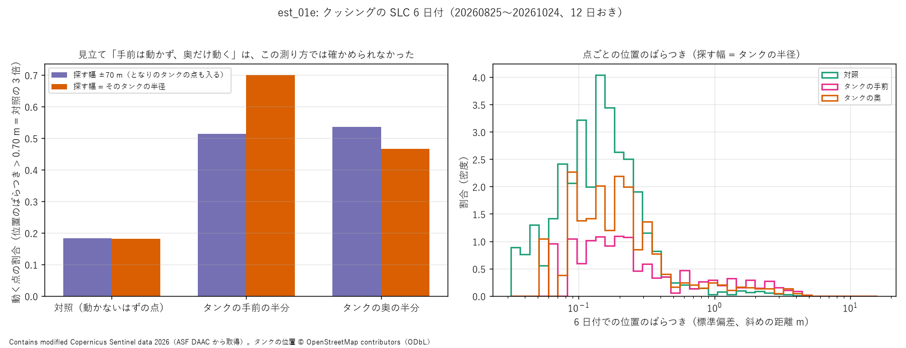

- **結論: 見立て「手前は動かず、奥だけ動く」は、この測り方では確かめられなかった（外れ）。** 探す幅を絞ると、むしろ手前のほうが動いて見えた。タンクの点がよく動くこと（対照の 3〜4 倍）は 6 日付でも変わらない
- ほかに分かったこと（探す幅 ±70 m）:
  - タンクでいちばん明るい点ほど動く（ばらつき 1.15 m、動く割合 60%）。対照では明るい点ほど動かない（30〜40 dB で 0.17 m）。タンクと建物で逆
  - 動きはなめらかでなく、日付ごとにでたらめに跳ぶ（隣の日付の差のばらつき / 全体のばらつき = 1.46。でたらめなら 1.41）。対照も同じ 1.46
  - 同じタンクの中の動く点どうしの動きの相関は弱い（中央値 0.24）
  - 動く点の幅（最大 − 最小）の中央値は 5.8 m（2.5 画素）
  - 明るすぎて数値が上限に張りついた画素はない（最大 23,847、上限 32,767）
- **考察（悪い結果の理由の見立てと、確かめ方）**:
  1. **タンクの中心の位置が、明るい点の側に引っぱられている（いちばん疑わしい）**。位置合わせ（est_01c の register）は「OSM の中心が明るい点に重なるように」ずらすので、中心が最も明るい点（屋根と壁の角かもしれない）の上に来やすい。すると、その点が中心の手前と奥を行き来し、手前と奥の分け方が意味をなさなくなる。探す幅を絞って細かく合わせ直したら、偏りがむしろ強まった（手前 70%）のも、この見立てと合う。
     確かめ方: タンクと関係ない目印（道路の交差点・建物）で位置を合わせる、または軌道と標高から正しく位置を計算する（ISCE3 などの定番の処理）。タンクの中心を独立に決めてから、手前・奥を分け直す
  2. **測り方そのものが、別の山を拾っている**。動かない対照でも 18% が「動く」と出て、動きは日付ごとにでたらめに跳ぶ。点が近くに並ぶと、補間した山の位置が隣の山に飛ぶと考えられる。
     確かめ方: 作り物（est_01）に「近くの別の点」を足して、取り違えの割合を数える。山を 1 つずつ追うのではなく、距離の向きの形（プロファイル）全体を日付どうしで相関させてずれを測る
  3. **タンクの反射は「点」ではなく「弧」**。円い壁と地面の角は、上から見ると弧（円の一部）で、どの部分が一番明るく写るかは、見る向きのわずかな違い（日付ごとの軌道の差、数十〜百 m）で変わりうる。いちばん明るい点ほど動くことと合う。
     確かめ方: 軌道の差（基線）と動きの大きさの関係を見る。基線の大きい日付ほど動くなら、この理由
  4. **屋根は本当に毎日のように動いていて、12 日おきでは追えない**。クッシングの在庫は週に数 % 変わる（知）ので、1 基の屋根が 12 日で何 m も上下してもおかしくない。それならでたらめな跳びは本物の動き。
     確かめ方: 1C と 1D（1 日違い）の組で、1 日の差を見る。EIA の週の在庫の変化と、動いたタンクの数・量の合計を比べる
- 次の一手: 理由 1 を先に潰す（位置合わせをタンクから独立させる）。これは安い（追加のダウンロードなし）

## est_02: 角の反射板で測り方を確かめる (est_02_corner_reflectors.py)
着想: 持ち主の依頼（2026-10-31 夜）で、タンクをいったん止めて、答えの分かった目印で測り方を確かめる（docs/landmarks.md）。est_01e で、タンクの点のぶれが測り方の雑音なのか、タンクの側の理由なのかが分けられなかった。
条件: すでに取ったクッシングの Sentinel-1D の SLC 6 日付（2026-08-25〜10-24、上昇軌道 34、VV）。その中に入るオクラホマの NISAR の反射板 4 基（N07K〜N10K、一辺 2.8 m、JPL の公開の座標、測量 2025-05-09）。反射板の座標の周りでいちばん明るい点を反射板とする。位置は est_01d と同じ測り方（8 倍の補間 + 放物線、周りの明るさの相関で日付のずれを引く）。

| 反射板 | 帯 | 日付 | SCR（中央値） | 距離の向きの位置のぶれ | 距離の向きの 3 dB の幅 / 尾の高さ | 進行方向の位置のぶれ | 進行方向の 3 dB の幅 / 尾の高さ |
|---|---|---|---|---|---|---|---|
| N07K | IW1 | 6 | 39.3 dB | **0.14 m** | 2.67 m / −21 dB | 3.86 m | 9.3 m / −0.5〜−2.4 dB |
| N08K | IW2 | 6 | 38.0 dB | **0.09 m** | 3.13 m / −21 dB | 0.70 m | 21.2 m / −20 dB |
| N09K | IW2 | 6 | 39.8 dB | **0.15 m** | 3.13 m / −21 dB | 3.55 m | 14〜28 m / −0.4〜−4.4 dB |
| N10K | IW2 | 3 | 31.9 dB | 0.17 m | 3.27 m / −21 dB | 1.36 m | 14〜18 m / −3〜−5 dB |
| （比較）est_01e の対照（町の建物などの強い点） | IW3 | 6 | 20 dB 以上 | 0.23 m | | | |
| （比較）est_01e のタンクの点（半径に絞った場合） | IW3 | 6 | 20 dB 以上 | 0.59〜1.64 m | | | |

- **結論: 答えの分かった点なら、距離の向きの位置は 6 日付で ±0.1〜0.15 m しかぶれない。** est_01e のタンクの点のぶれ（0.6〜1.6 m）はこの 4〜10 倍なので、**タンクのぶれは測り方の雑音ではなく、タンクの側に理由がある**（est_01e の考察の 2「測り方が隣の山を拾う」は、孤立した点については外れ。残る候補は 1 位置合わせ・3 弧・4 本当の動き、と、点が近くに並ぶ場合の取り違え）
- 反射板の明るさ（SCR 38〜40 dB）は、計算の目安（一辺 2.8 m で約 49 dBm²、背景 −10 dB）とおおよそ合う
- 距離の向きのぼけの形はそろっている（3 dB の幅 2.7〜3.3 m、尾の高さ −21 dB。窓関数をかけた sinc の形と考えられる）。est_01 の作り物（分解能 2.7 m・窓なし）は幅はほぼ合うが、尾の高さは実物（−21 dB）のほうがずっと低い（窓なしの sinc は −13 dB）
- **進行方向は測れていない（悪い結果）**: 4 基のうち 3 基で、進行方向の幅が 9〜28 m と日付でばらつき、尾の高さが主の山とほぼ同じ（−0.5〜−4 dB）。N08K だけがきれい（21 m・−20 dB）。
  - 考察: Sentinel-1 の IW モード（TOPS）の SLC は、バーストの中で進行方向の周波数の中心が場所によって動く（位相に傾きがある）。私の補間は「周波数の中心は 0」と仮定してゼロを詰めているので、中心からずれた所ではぼけの形が壊れる。N08K だけきれいなのは、バーストの中心近くにあったためと考えられる。
  - 確かめ方: 進行方向の位相の傾きを取り除く処理（deramp、ESA の資料にある定番の処理）を入れて、4 基とも幅が約 20 m・尾が −20 dB 前後にそろうかを見る
- GCP（付属の目印の点）での予測と実際のずれは、反射板ごとに −113〜+54 行と大きく違うが、同じ反射板では 6 日付でほぼ同じ（±2 行）。GCP のずれは場所で変わるが時間では変わらない。N10K だけずれが +191 列（約 450 m）と大きく、日付も 3 つしか見つからなかったので、**別の明るい物を反射板と取り違えた可能性がある**（N10K の値は参考まで）
- 次の一手: (1) 進行方向の deramp を入れる (2) 反射板の正しい位置（軌道と時刻から計算した位置）と比べて、画像の位置の絶対の精度を測る (3) その上で、タンクの位置合わせ（est_01e の理由 1）を反射板や道路の交差点で直す

## est_03: 点どうしの関係を周波数成分として見る (est_03_point_relations.py、tools/fig_est03.py)
着想: 持ち主の問い（2026-10-31 夜）「3 点以上（2 次元の面）の点どうしの関係を周波数成分にできるか。時間ごとに変化する点間の周波数成分に関係があるか。1 つの基準物で実験できる」。
考え方: 2 つの日付の SLC の掛け算 z_i(t)·conj(z_i(0)) の位相は、点 i の距離の変化を波長の半分（2.8 cm）で 1 周として表す（干渉 SAR）。点を並べると位相は点の位置に対して「縞」になり、縞の細かさ（点どうしの関係の空間の周波数）は 2 回の撮影の位置の差（基線）で日付の組ごとに変わるはず。縞を引いた残り = 点ごとの本当の動き・高さの違い。
条件: Sentinel-1D の SLC 6 日付（2026-08-25〜10-24、上昇軌道 34）。範囲 約 1.3 km × 1.7 km。日付ごとに明るさの相関で画素より細かく重ね、位相を保ってずらす。動かない点 = 背景より X dB 以上の山で、6 日付の振幅のばらつき / 平均 < 0.25〜0.35（干渉 SAR の定番の選び方）。縞は「点の並びの 2 次元の周波数成分」（Σ exp(i(φ_i − k·r_i)) の大きさが最大の k）で探す。
確かめ: (1) 偶然の水準 = 位相をでたらめにして同じ探し方をしたときのそろい具合（点が少ないと高く出る）、(2) 閉じ具合 = 本物の縞なら (i→j) + (j→k) = (i→k)。

| 場所 | 点の数 | 縞（距離の向き、本/km） | そろい具合: 縞を引く前 → 後 | 偶然の水準（95%） | 閉じ具合の差（中央値） | 縞を引いた残り |
|---|---|---|---|---|---|---|
| **クッシングの町（建物）**、12 dB・ばらつき < 0.25 | 69 | −1.25〜+5.13 | 0.12〜0.37 → **0.86〜0.92** | 0.39 | **0.00 本/km**（縞のばらつき 2.96） | **約 2 mm** |
| クッシングの町、20 dB | 10 | 同じ | → 0.94〜0.97 | 0.89 | 0.00 | 1〜1.6 mm |
| 反射板 N08K の周り（畑）、10 dB・ばらつき < 0.35 | 29 | +1.1〜+6.9 | 0.23〜0.52 → 0.60〜0.66 | 0.60 | 4.75 本/km（縞のばらつき 3.6） | 約 4.5 mm |

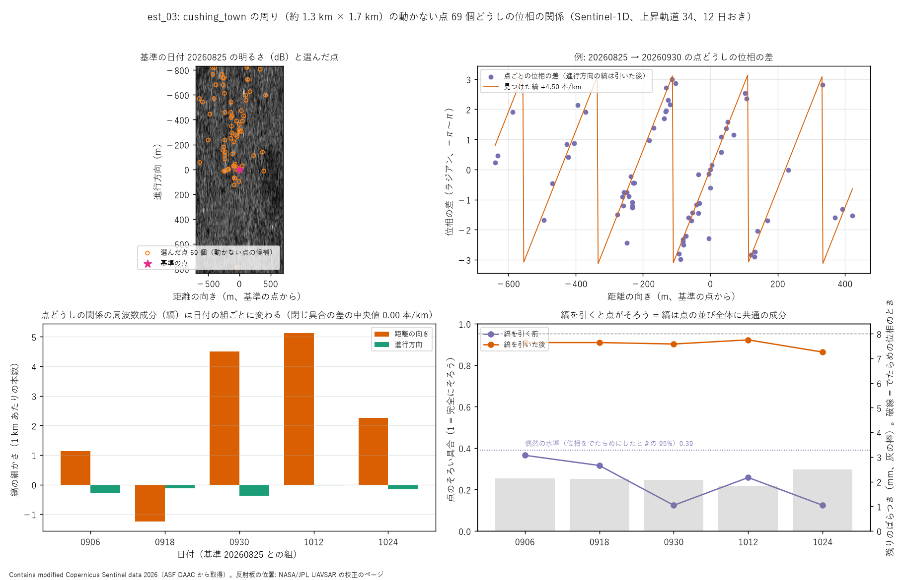

- **結論: 動かない点が十分にある場所（町）では、点どうしの位相の関係は「日付の組ごとの 1 本の縞」という周波数成分でよく説明でき、その周波数は日付の組ごとに変わり、組どうしで矛盾なく足し引きできる。** 縞を引いた残りは約 2 mm で、点ごとの小さな動きや高さの違いの大きさを表すと考えられる
- 縞の細かさ 1〜5 本/km は、衛星の位置の差（基線）が数十〜百数十 m のときの見込み（2B⊥ / (λR tanθ) ≈ B⊥ 100 m で約 5 本/km、知）と同じ桁。縞は主に基線の違いでできていると考えられる（確かめるには軌道の情報から基線を計算して並べる）
- **反射板 N08K の周り（畑）では、偶然と区別できなかった（悪い結果）**。考察: 畑の中には強く動かない点がほとんどない（15 dB 以上で振幅の安定した点は 5 個だけ）。弱い点は 12 日で反射の仕方が変わるので位相がそろわない。点が少ないと、縞の探し方そのものが偶然でも「そろって見える」（偶然の水準 0.60）。基準物 1 つで試すなら、反射板を 3 基以上並べるか、町の中の基準物を使うのがよい
- 持ち主の問いへの答え: 点が 3 つ以上あれば、点どうしの関係を周波数成分（縞）として取り出せる。時間（日付の組）ごとの変化は主に衛星の位置の差で決まり、それを引いた残りに物の動き（mm の桁）が残る。温度の伸び縮み（docs/landmarks.md）は、この残りに出るはず
- 次の一手: (1) 基線を軌道の情報から計算して縞と比べる (2) 残り（mm）の時系列を、気温と比べる（伸び縮み）(3) 進行方向の補正（deramp）を入れる

## 実験02: 角の反射板を見分ける (exp02_cr_chips.py、sweep02.sh・sweep02g.sh、tools/fig_exp02.py)
着想: 持ち主の依頼（2026-10-31 夜）「複数の角度や違う日の同じ点、オクラホマの同じ形の反射の点を、訓練とテストに分けて学習」。
条件: Sentinel-1D の SLC、上昇軌道 2 本（34: 6 日付、107: 4 日付 × 2 場面）。反射板 = 予測の距離の向き ±60 画素の帯で背景より 30 dB 以上の山（GCP の取り違えを防ぐ。est_02 の N10K）。切り出し 933 個（反射板 49・ほかの明るい点 315・背景 569）、48 × 48 の複素数を最も明るい画素の振幅で割ってそろえる（明るさの強さで当てないため）。学習では 32 × 32 をずらし、全体の位相を回す。3000 steps、3 seed。
分け方: 反射板ごと（テスト = N02K・N05K・N09K・N12K・N16K、訓練で一度も見ない。テスト 299 個のうち反射板 14）／日付（新しい 1/4 の日付をテスト、222 個のうち反射板 12）。
注: 最初に CPU で途中まで回した分と GPU で回し直した分が重なったので、同じ (条件, 分け方, seed) は新しいほうだけを使った。

| 条件 | 学習する数 | 反射板ごと: 正解率 / 反射板の再現率 / 適合率 | 日付: 正解率 / 再現率 / 適合率 |
|---|---|---|---|
| 明るさの強さだけ（そろえる前の dB、しきい値 2 本） | 2 | **99.7** / 92.9 / 100 | **97.3** / 66.7 / 80.0 |
| 手で作った特徴（上位 10 画素 + 平均）+ ロジスティック回帰 | 36 | 91.0 / **100** / 87.5 | 88.7 / 50.0 / 66.7 |
| 小さな CNN（振幅） | 1,659 | **93.7±0.0 / 100±0 / 100±0** | **94.4±0.6** / 86.1±2.8 / 83.8±0.4 |
| 小さな CNN（複素数: 実部・虚部） | 1,959 | 87.3±2.9 / 97.6±2.4 / 83.5±6.9 | 92.2±0.5 / 86.1±2.8 / **89.3±5.4** |
| Sin の板（振幅を光の場に） | 1,028 | 81.7±1.6 / 81.0±4.8 / 84.9±0.8 | 85.0±1.6 / 83.3±0.0 / 73.0±7.3 |
| Sin の板（複素数のまま光の場に） | 1,028 | 50.8±0.8 / 78.6±4.1 / 21.5±1.1 | 51.6±0.7 / 80.6±5.6 / 22.9±0.5 |
| （偶然: いつも「背景」） | 0 | 53.8 / 0 / − | 61.7 / 0 / − |

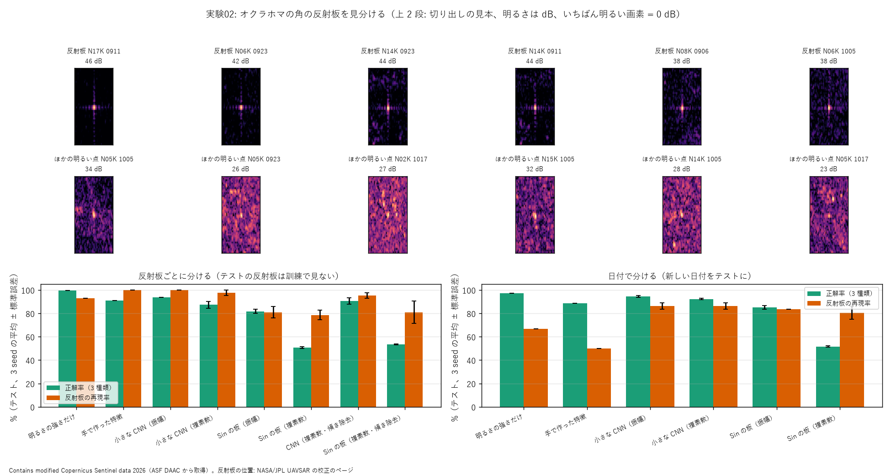

- **結論: 反射板は、明るさをそろえても形（十字のぼけ）だけで見分けられる（CNN（振幅）は見たことのない反射板でも見落としなし・誤りなし）。ただし Sin の板は CNN に届かず（81.7 対 93.7%）、複素数のまま入れると偶然並みに崩れた（50.8%）。** 明るさの強さだけでも 99.7% なので、この課題は「反射板は明るい」で解けてしまう。形の学習の課題としては、明るさをそろえた条件の値を見る
- **考察（Sin の板が複素数で崩れた理由の見立て）**:
  1. **SLC の位相の傾き（いちばん疑わしい）**: Sentinel-1 の IW の SLC は、進行方向の周波数の中心が場所によって動く（est_02 で進行方向のぼけが崩れたのと同じ原因）。光の場では「斜めから照らす」のと同じで、レンズの後の像がまるごと横にずれる。Sin の板はスクリーンの決まった窓の明るさで答えるので、像がずれると答えがでたらめになる。振幅だけにすると傾きが消えて 81.7% に戻るのと合う。CNN は位置のずれに強い（畳み込み + 最大）ので、複素数でも 87% に留まる。
     確かめ方: 切り出しごとに周波数の重心を 0 に戻す（--recenter、簡単な deramp）。
     **結果（sweep02r.sh、反射板ごと、3 seed）: Sin の板（複素数）53.3±0.4%（再現率 81.0・適合率 27.9）、CNN（複素数）90.5±2.6%。Sin の板はほとんど戻らなかった → 見立て 1 は外れ（少なくとも主な原因ではない）。** 残る候補は 2（斑点のでたらめな位相）。振幅だけにすると 81.7% に戻ることと合う。
     斑点の多い切り出しでは周波数の重心の見積もりそのものがぶれる。軌道の情報を使った正式な deramp は、持ち主の方針（2026-11-01、軌道の補正はしない）で使わない。代わりに干渉データ（日付どうしの掛け算）で斑点の位相を打ち消す
  2. 斑点の位相はでたらめで、Sin の板にとっては「でたらめな位相の板」を 1 枚足したのと同じになる。振幅にすれば消える
  3. 学習する数が CNN より少ない（1,028 対 1,659〜1,959）。ただし差は 2 倍以内で、崩れ方（50%）を説明するには小さい
- 日付で分けると、明るさだけ・手で作った特徴の再現率が下がる（67%・50%）。新しい日付の反射板には、107 番の軌道（別の角度）のものが多く、明るさや形の目安がずれたと考えられる
- 次の一手: 位相の傾きを取り除いた版の結果を見る。Sin の板の読み方を、位置のずれに強いもの（4f 系の相関器、SN2-Parts-2D 実験75〜77 の「4f 系 + 平方根」）にする

## 実験03: 真ん中を隠して、周りの成分だけで反射板を当てる (exp02_cr_chips.py --mask --lowpass、sweep03g.sh、tools/fig_exp03.py)
着想: 持ち主の問い（2026-10-31 夜）「飛行機が点として映らなくても、その周辺には飛行機と関連のある周波数成分がまき散らされている可能性はないか。周辺の反射を畳み込んで広げて学習して確かめる」。飛行機の前に、答えの分かる反射板で確かめる。
条件: 実験02 と同じデータ・反射板ごとの分け方。切り出しの真ん中（距離の向き 半径 r 画素、進行方向 r/6 行・最低 1 行の楕円）を 0 にし、**残りの最大の振幅で割り直す**（割り直さないと「隠した所がとても明るかった」ことが周りの暗さとして漏れる）。分解能そのままと 1/4（10 m 相当）。3 seed。

| 分解能 | 隠す半径 | 隠したあとに残る最大（元の山との比） | CNN: 再現率 / 適合率 | Sin の板: 再現率 / 適合率 | 手で作った特徴: 再現率 / 適合率 |
|---|---|---|---|---|---|
| そのまま | 2 | −6 dB（**山の一部が残る**） | 97.6 / 91.7 | 61.9 / 23.9 | 97.6 / 93.2 |
| そのまま | 4 | −6 dB（同） | 100 / 91.4 | 64.3 / 28.0 | 100 / 93.3 |
| そのまま | **8** | **−20 dB（尾だけ）** | **40.5±2.4 / 54.5±9.8** | 11.9±6.3 / 7.6±4.3 | 0 / 0 |
| 1/4 | 2・4・8 | −1 dB（**ほぼ全部残る**） | 79〜86 / 53〜61 | 88〜95 / 45〜51 | 57〜64 / 47〜60 |
| （偶然の適合率 = テストの中の反射板の割合） | | | 4.7 | | |

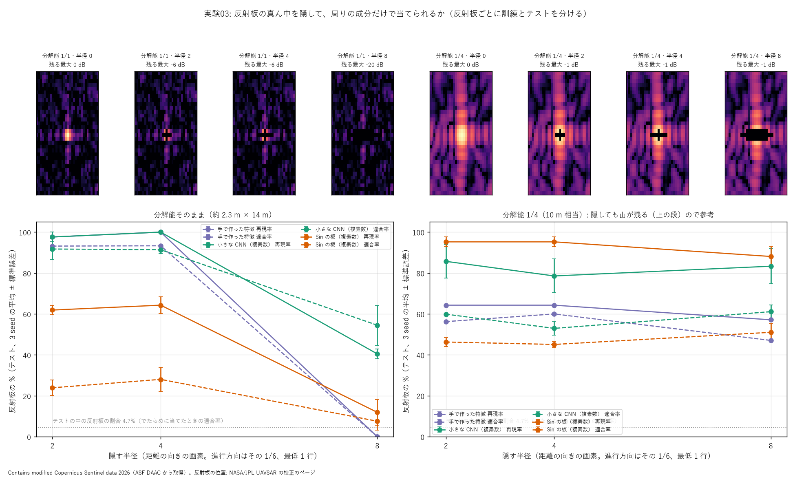

- **結論: 山を隠して十字の尾（−20 dB 以下）だけを残しても、CNN は見たことのない反射板の 4 割を、半分以上の確かさで当てた（偶然 4.7%）。持ち主の見立て「周りに、その物と関係のある成分がまき散らされている」は、強い点については成り立つ。** ただし手で作った特徴（明るさの並び）は 0 で、尾の「形（十字の向き・間隔）」を見る必要がある
- **うまくいかなかったこと（悪い結果）**: 半径 2・4 は隠し方が足りず、進行方向に山が残った（−6 dB）。分解能 1/4 では山が広がって、どの半径でもほぼ全部残った（−1 dB）。この 2 つは「周りだけで当てる」試験になっていない。考察: 隠す形を、実際のぼけの形（明るさが −15 dB を超える範囲）に合わせる必要がある。とくに進行方向の画素は距離の向きの約 6 倍長く、1 行の隠しでは足りない
- Sin の板は、隠すと CNN より大きく落ちた（実験02 の位相の傾きの問題が重なっていると考えられる）。一方、分解能 1/4 では Sin の板の再現率がいちばん高い（88〜95%）。粗い画像では広がった十字の形を光の回折で拾いやすいのかもしれない（見立て、確かめはまだ）
- 次の一手: (1) 隠す形をぼけの形に合わせて、分解能 1/4 でもやり直す (2) 飛行機: 民間の空港・保管場の高分解能のデータ（Umbra・Capella）を探し、同じ「真ん中を隠す」試験をする

## 実験04: 2 日付の干渉データで反射板を見分ける (exp02_cr_chips.py --data ifg_chips、tools/build_cr_ifg_chips.py、sweep04g.sh、tools/fig_exp04.py)
着想: 実験02 で Sin の板が複素数で崩れた理由の残りの候補 = 斑点のでたらめな位相。持ち主の方針（2026-11-01）「軌道の情報は使わず、同じタイミングで測ったものの相関だけ。干渉データとかで」。動かない点では、2 日付の掛け算 A·conj(B) で斑点の位相が打ち消し合うはず。
条件: 同じ軌道のとなりの日付の組（12 日おき）。B を明るさの相関で A に重ね（周波数の側で位相を保ってずらす）、I = A·conj(B) から 48 × 48 を切り出す（反射板・日付 A で選んだ明るい点・背景）。切り出し 709 個（反射板 37・明るい点 242・背景 430）。反射板の干渉の位相のそろい（3 × 3 の中）は中央値 1.00（最小 0.91）。ほかは実験02 と同じ（反射板ごとに分ける、テスト 231 個のうち反射板 11、3000 steps、3 seed）。
注: 最初の 1 回は、干渉データが倍精度で保存されていて CNN が型の誤りで止まった。単精度にそろえて回し直した。

| 条件 | 1 日付の SLC（実験02）: 正解率 / 反射板の再現率 / 適合率 | 2 日付の干渉データ（実験04）: 正解率 / 再現率 / 適合率 |
|---|---|---|
| 小さな CNN（振幅） | **93.7** / 100 / **100** | 86.6±2.0 / 100 / **80.6±2.0** |
| 小さな CNN（複素数） | 87.3±2.9 / 97.6 / 83.5 | **88.9±2.3** / 100 / 63.5±6.1 |
| Sin の板（振幅） | 81.7±1.6 / 81.0 / 84.9 | 86.0±1.7 / 100 / 42.2±2.9 |
| **Sin の板（複素数）** | 50.8±0.8 / 78.6 / 21.5 | **64.8±1.4** / 84.9±6.1 / 24.6±0.6 |
| （偶然: いつも「背景」） | 53.8 | 54.1 |

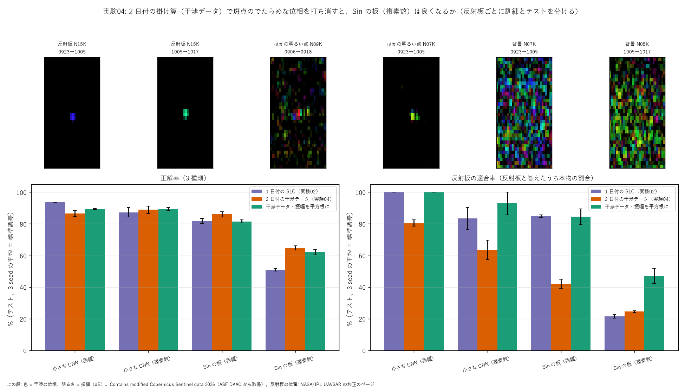

- **結論: 干渉データにすると、Sin の板（複素数）は 50.8 → 64.8% と 14 ポイント上がった。斑点のでたらめな位相が崩れの一因だった、という見立てに合う。ただし振幅だけの Sin の板（86.0%）や CNN（86.6〜88.9%）には届かない。** 反射板と答えた中に、背景や明るい点の取り違えが多い（適合率 24.6%）
- CNN（複素数）は、干渉データでは振幅より良くなった（88.9 対 86.6%）。位相が「使える情報」に変わったと考えられる（1 日付では逆で、87.3 対 93.7%）
- **悪くなった点（考察）**: 1 日付で強かった CNN（振幅）が 93.7 → 86.6% に下がった。掛け算で明るさの幅が 2 乗になり（尾が −21 dB → −42 dB）、反射板の十字の尾がほとんど見えなくなった（図の上の段: 反射板が「1 点」に写る）。形の手がかりが減ったと考えられる。また、テストの数・組み合わせも実験02 とは違う（干渉の組が作れたものだけ）ので、完全に同じ条件の比較ではない
- Sin の板（複素数）がまだ低い理由の見立て: (1) 1 点で位相が一様な反射板は、レンズの後でほぼ一様な明るさになり、窓の差が出にくい（点の像の周波数成分は平らなため）(2) 背景の干渉データは、明るさがそろったでたらめな位相の場で、窓の明るさがでたらめに偏る → 反射板と取り違える
- 確かめ: 振幅を平方根にして明るさの幅を 1 日付と同じに戻した版（--sqrt-amp、sweep04s.sh、3 seed）:

| 条件（干渉データ・振幅を平方根に） | 正解率 | 反射板の再現率 | 適合率 | 取り違えの表（3 seed の合計、行 = 本当: 背景・明るい点・反射板） |
|---|---|---|---|---|
| 小さな CNN（振幅） | **89.3±0.4** | **100** | **100** | |
| 小さな CNN（複素数） | **89.3±0.9** | 90.9±5.2 | 92.9±7.1 | |
| Sin の板（振幅） | 81.5±0.9 | 78.8±8.0 | 84.5±4.8 | [[320, 55, 0], [61, 219, 5], [0, 7, 26]] |
| Sin の板（複素数） | 62.1±1.8 | **97.0±3.0** | 47.1±4.8 | [[245, 118, 12], [107, 153, 25], [1, 0, 32]] |

  - **CNN（振幅）は平方根で 100 / 100 に戻った → 「掛け算で尾が見えなくなった」見立ては当たり。** Sin の板（複素数）は反射板をほぼ全部見つけ（97%）、適合率も 24.6 → 47.1% に上がった。全体の正解率が低いのは、**背景とほかの明るい点の取り違え**（表の左上 2 × 2）が大半
  - 考察: ほかの明るい点（建物・機械など）は 12 日で反射の仕方が変わり、干渉データでは位相がでたらめになる（反射板の位相のそろいは 1.00 だが、ほかの点はそろわない）。Sin の板（複素数）にとっては、でたらめな位相の背景と区別しにくい。振幅を入れれば区別できる（Sin の板（振幅）は 0 と 1 をよく分ける）。→ 次は「振幅」と「干渉の位相」を両方入れる（2 本の光路の明るさを足す、SN2-Parts-2D の並列光路の融合の形）

## 実験05: 2 本の光路の融合（振幅 + 干渉の位相） (exp02_cr_chips.py --model fuse、sweep05g.sh、tools/fig_exp05.py)
着想: 実験04 の確かめで、反射板（動かない点）は干渉の位相で、ほかの明るい点は振幅で見分けるのが向いていると分かった。SN2-Parts-2D の並列光路の融合（明るさを足す）の形で、両方を 1 つにする（持ち主の了承 2026-11-01）。
条件: 干渉データ・振幅を平方根に（実験04 の確かめと同じ）。融合 = 光路 a（振幅、板 8 枚）+ 光路 b（複素数、板 8 枚）の窓のスコアを足し、一緒に学習。比較: 1 本の光路で板 16 枚（学習する数をそろえる）。反射板ごとに分ける、3000 steps、3 seed。

| 条件 | 学習する数 | 正解率 | 反射板の再現率 | 適合率 | 取り違えの表（3 seed の合計、行 = 本当: 背景・明るい点・反射板） |
|---|---|---|---|---|---|
| 小さな CNN（振幅）（実験04 の確かめ） | 1,659 | **89.3±0.4** | **100** | **100** | |
| Sin の板（振幅、8 枚）（同） | 1,028 | 81.5±0.9 | 78.8±8.0 | 84.5±4.8 | |
| Sin の板（複素数、8 枚）（同） | 1,028 | 62.1±1.8 | 97.0±3.0 | 47.1±4.8 | |
| Sin の板（振幅、16 枚） | 2,052 | 82.7±0.3 | 93.9±3.0 | 93.9±3.0 | [[325, 50, 0], [66, 217, 2], [0, 2, 31]] |
| Sin の板（複素数、16 枚） | 2,052 | 67.5±0.4 | **100** | 60.3±2.8 | [[276, 94, 5], [109, 159, 17], [0, 0, 33]] |
| **2 本の光路の融合**（振幅 8 + 複素数 8） | 2,056 | **83.7±1.0** | 90.9±5.2 | 88.6±7.3 | [[325, 50, 0], [56, 225, 4], [0, 3, 30]] |

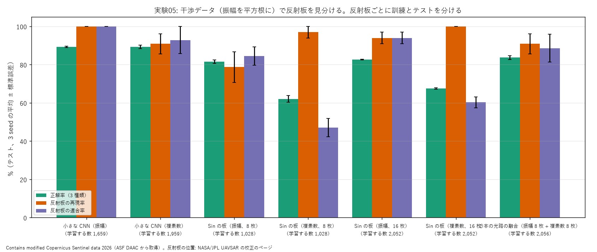

- **結論: 融合は 83.7% で、学習する数をそろえた振幅だけの 1 本（82.7%）とほぼ同じ（差は標準誤差の範囲）。干渉の位相の光路の上乗せは、この課題では見えなかった。** CNN（89.3%）にはまだ 5.6 ポイント届かない
- 板を 16 枚にすると、複素数の 1 本は 62.1 → 67.5%（適合率 47 → 60%）と上がった。容量（板の枚数）も足りていなかったと考えられる
- 考察（上乗せが見えなかった理由の見立て）: (1) この課題の反射板は、振幅の形（十字の尾）だけでほぼ見分けられる（振幅の 16 枚で再現率・適合率とも 94%）。位相の手がかりが効く余地が小さい (2) 2 本を最初から一緒に学ぶと、学びやすい振幅の光路が先に答えを覚えて、位相の光路があまり学ばない（取り違えの表が振幅の 16 枚とほぼ同じ）。別々に学んでから足す（SN2-Parts-2D の融合の本来の形）なら、役割が分かれるかもしれない (3) 背景と明るい点の取り違え（表の左上 2 × 2）はどの Sin の板にも残る。CNN との差はここにある
- 次の一手: 別々に学んでから足す融合、Sin の板の読み方を位置のずれに強いもの（4f 系の相関器）にする

## est_04: 駐機位置ごとの明るさの時系列（飛行機がいる・いないの仮の正解の候補） (est_04_stand_brightness.py、tools/fig_est04.py・fig_est04b.py)
着想: 持ち主の案（2026-11-01）「飛行機があるエリアとないエリアで板が学習できれば、次は駐機機種の割合」。飛行機 1 機ずつの正解はないので、駐機位置の明るさが日付ごとに「強い日（機体がいる）」「弱い日（なめらかな舗装 = 暗い）」に分かれれば、それを仮の正解にする。
条件: バンコク（スワンナプーム）、Umbra の GEC 24 日付（2023-02〜2025-10、期間から均等に間引き）。駐機位置 = OSM の parking_position 190 か所。半径 20 m の明るさ（8 ビットの値の 2 乗）を、その日の駐機場（OSM の apron の面）の中央値で割る（dB）。駐機位置ごとに 2 つの正規分布を当てはめる。

| 指標 | 全 24 日付 | 同じ版の 2023 年の 16 日付だけ（日付の中央値を引いた後） |
|---|---|---|
| 2 つの山に分かれる駐機位置（d' > 2） | 82% | − |
| 強い日の割合（中央値） | 21% | 0%（+6 dB 以上の日が 1 回でもある駐機位置は 37%） |
| 日付ごとの中央値 | 2023 年 0.3〜2.4 dB、**2024-02 以降 4.3〜17.6 dB** | |

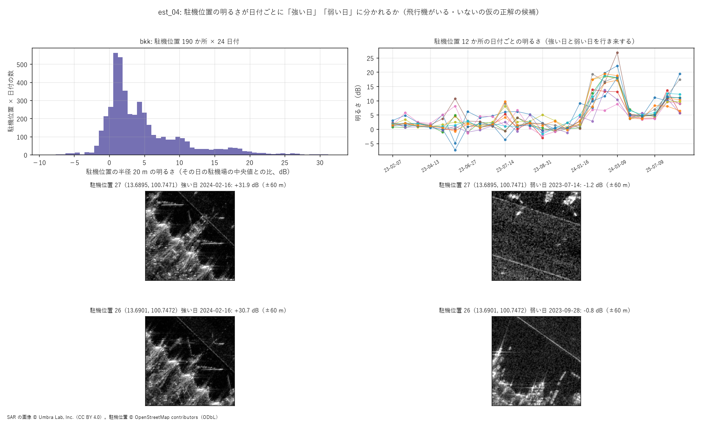
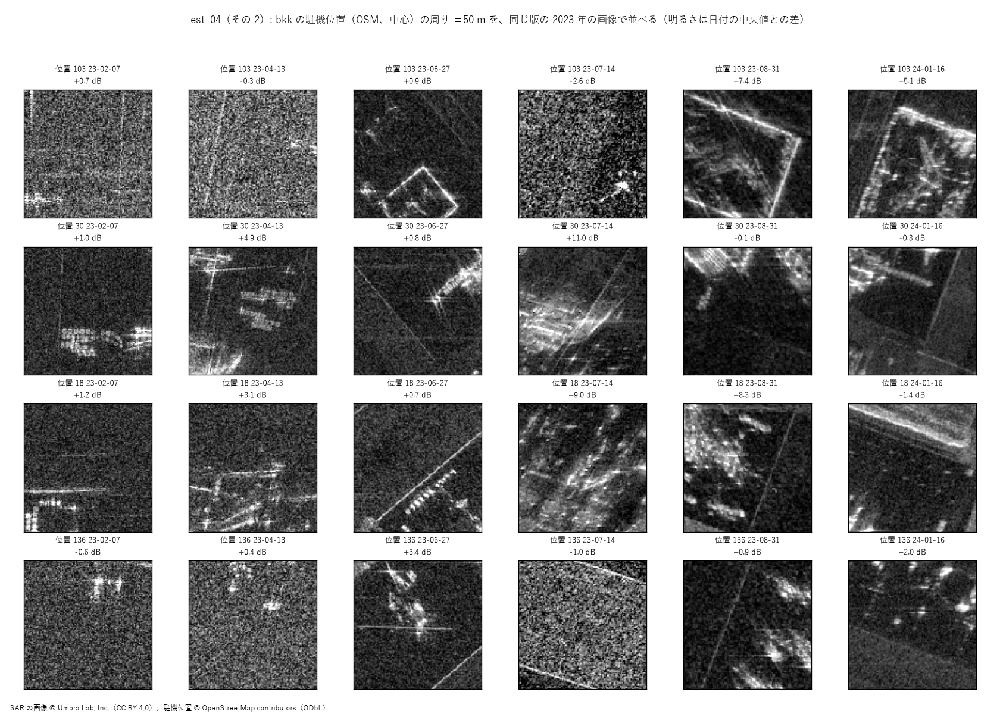

- **結論（悪い結果）: 最初に見えた「強い日・弱い日」は、飛行機ではなかった。** (1) 2024 年 2 月以降の画像（座標の決め方も経度・緯度に変わった、作り方の違う版）は、駐機場の中央値でならしてもまとめて明るい（日付ごとの中央値が 2023 年の 1 dB 前後に対して 4〜18 dB）(2) 同じ駐機位置の切り出しに、日付ごとに別の物（建物の角・誘導路・別の機体）が写っている（下の図）。日付ごとに画像の位置が数十 m ずれ、見る向きも変わるため、高い物の倒れ込みも変わる
- 一方、2024-02-16 の画像には、翼の形の明るい物が並んで写っている（上の図の左下）。飛行機そのものは高分解能の画像ではっきり写る
- 考察と次の一手: 日付をまたいで同じ場所を比べるには、**データどうしの相関で位置を合わせ直す**必要がある（持ち主の方針の範囲: 滑走路・ターミナルなど動かない大きな形の相関で、日付ごとのずれを求める）。版の違う画像は、明るさの物差しを別にする（版ごとにならす）か、分けて扱う。そのうえで、駐機位置の切り出しを並べ直して、目で「いる・いない」が分かるかを確かめる

### est_04 の続き: データの相関で位置を合わせ直す (tools/align_gec.py、experiments/est_04d_stands_aligned.py、tools/fig_est04c.py)
- 位置合わせ: 24 日付を UTM の 1 m の共通の格子に置き直し、4 m に粗くして明るさを順位にそろえ、位相だけの相関でずれを求めた。基準（2023-02-07）からのずれは東 −100〜+40 m・北 −12〜+28 m、相関の山の強さ 15〜67（はっきりした山）。ほかの日付どうしは東 −40 m・北 +12 m 付近に集まり、**基準の日付のほうがずれていた**ので、ずれの中央値を「多数の日付の位置」として駐機位置を動かした
- 合わせ直した画像では、同じ駐機位置の切り出しに同じ道路・建物の縁が写るようになった（下の図）。駐機位置の近くに、日によって機体らしい明るい形が出たり消えたりしている（位置 30・136）

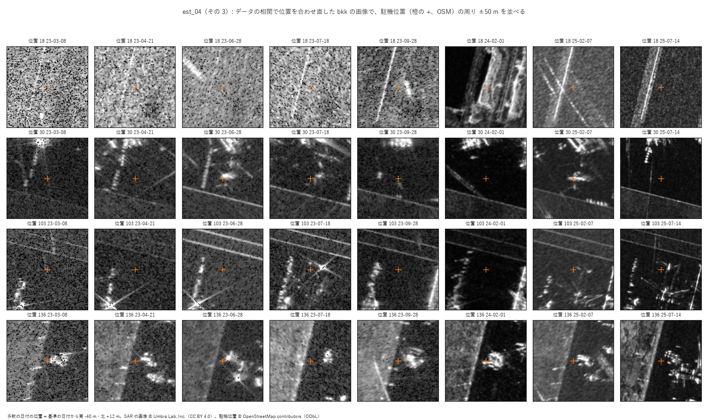

- 数え直し（est_04d）: 駐機位置の半径 20 m の中の「その画像の上位 5% より明るい画素」の割合を、駐機場の中の離れた点（対照 300 点）の 95% と比べた。**1 度でも対照を超えた駐機位置は 43%、超える日の割合の中央値は 0%（悪い結果）**。飛行機は目で見ると写っているのに、この単純な数え方ではほとんど「いない」と出た
- 考察: (1) OSM の駐機位置の点は「機首の止まる所」で、機体（長さ 40〜70 m）の大部分は点から後ろにある。半径 20 m の円では機体の一部しか入らない (2) 飛行機のなめらかな胴体は電波を鏡のように逃がし、明るいのはエンジン・翼の付け根などの点だけ。明るい画素の割合は小さい (3) 版ごとに分解能が 0.3〜0.6 m と違い、上位 5% のしきい値の意味が揃わない
- 次の一手: 決め打ちの数え方ではなく、日付どうしの差（合わせ直した画像の差）で「変わった所」を探す。あわせて、OSM の地物の種類（駐機場・誘導路・滑走路・ターミナル）を正解にした「場所の種類の確率」の学習（実験06）を先に進める（持ち主の「類似する地点を確率で」）
