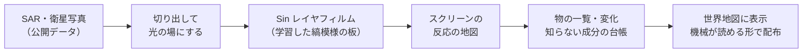

# Project Zuikoh — レーダ衛星と光の板で、世界の変化と動きを見る

> **開発中です（骨組みの段階、まだ部品はありません）。** いまは使えるデータの調査と、最初の到達点の設計をしています。

合成開口レーダ（SAR）・衛星写真・公開されている運行データ（船など）から、建物の変化、遺跡の捜索、船や電車の運行などを**時系列で見えるようにする**システムを作るプロジェクトです。
最終的には、地図の上の表示と、機械が読めるデータの形で、人の判断や AI の研究に使えるようにします。



## これは何？

- **SAR（合成開口レーダ）** は、衛星から電波を当てて、戻ってきた電波で地面を写す仕組みです。雲があっても夜でも写ります。
- **Sin レイヤフィルム** は、光の通り道に置いた「縞模様の透明な板」を学習で決めたものです。光（ここでは SAR の画像を光に見立てたもの）が板を通って広がると、スクリーンのどこかが明るくなります。どこが光るかで「そこに何があるか」を調べます。
- 1960 年代の SAR の画像は、レンズと光の計算機で作られていました。SAR のデータは光のホログラムに似ているので、光の板と相性が良いと考えています（確かめるのはこれから）。

関係するプロジェクト: 光の板の学習器 [Sin-CNN2](https://github.com/devaf09/Sin-CNN2)（1 次元）→ [SN2-Parts-2D](https://github.com/devaf09/SN2-Parts-2D)（2 次元の部品）→ [Project_Metasequoia](https://github.com/devaf09/Project_Metasequoia)（画像の分類と技能の融合）。[Sin-CNN3](https://github.com/devaf09/Sin-CNN3) はフーリエ変換による記憶を作り直しています。このプロジェクトは、それらを地球の観測に使います。

## 進め方（到達点）

| 到達点 | 中身 | 状況 |
|---|---|---|
| M0 | 道具とデータの確認、小さな見本を地図に表示 | 調査中（[データの出どころ](docs/data_sources.md)、[先行研究](docs/prior_art.md)） |
| M1 | 同じ形の物（石油タンクなど）で、板の反応を定番の検出（CFAR）・小さな CNN と比べる | 設計中（[設計の提案](docs/design_m0_m1.md)） |
| M2 | 衛星写真と SAR を一緒に学ぶ（トウモロコシ畑の季節の時系列） | 未着手 |
| M3 | 変化から「知らない成分」を取り出して連番で登録 | 未着手 |
| M4 | 登録と単離の繰り返し、船・電車へ | 未着手 |
| M5 | 地図の表示と、受け渡しの形を整える | 未着手 |

## フォルダの構成

| 場所 | 中身 |
|---|---|
| `zuikoh/` | データの取り込み・地図・台帳などの部品（いまは設定の読み込みだけ） |
| `vendor/` | 別のリポジトリから版番号つきで写したコード（SinWave2D 0.3.0、SN2-Parts-2D 0.11.0。出典は vendor/README.md） |
| `experiments/`, `experiments/sweeps/` | 実験のプログラムと、そのまま再実行できる条件の一覧 |
| `results/` | 結果（1 回の実行 = 1 行の JSON） |
| `tools/` | 集計・図・データの取得のプログラム |
| `tests/` | 部品の確認（pytest） |
| `docs/` | 説明・設計・調査の文書、図（docs/images/） |
| `NOTES.md` | 研究者向けの実験ノート（数字の正本） |

データ（衛星の画像など）は大きいので、このリポジトリには入れません。置き場は `config.example.toml` を `config.local.toml` に写して設定するか、環境変数 `ZUIKOH_DATA` で指定します。

テスト:

```bash
python -m pytest tests -q
```

## ライセンスとデータの出典

- コードと文書は [MIT License](LICENSE)。`vendor/` のコードも同じ作者の MIT です。
- データは含めていません。使うデータはそれぞれの条件に従います（一覧と出典の表記は [docs/data_sources.md](docs/data_sources.md)）。例: Sentinel-1 は「Contains modified Copernicus Sentinel data [年]」、Planetary Computer の Sentinel-1 RTC は CC BY 4.0、Umbra・Capella のオープンデータは CC BY 4.0。
- 一部を将来非公開にすることがあります。
